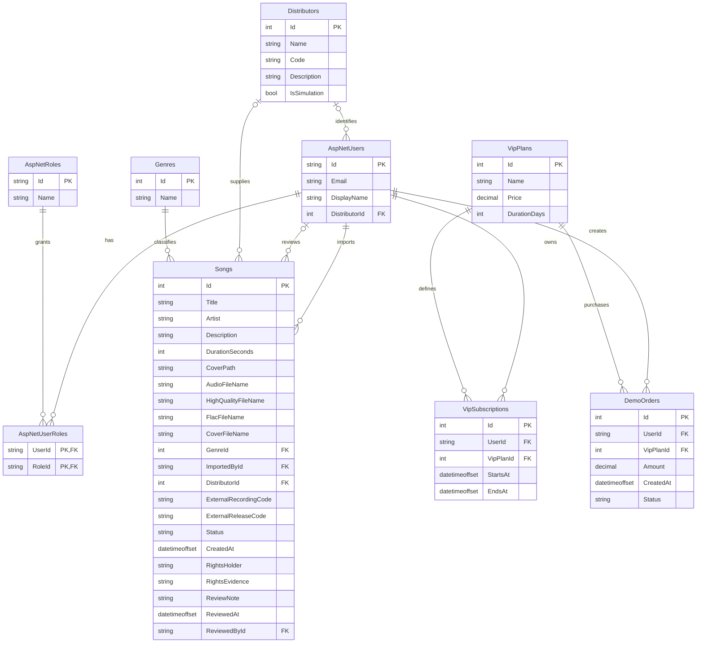

# Dữ liệu và phân quyền

## Ba vai trò và dữ liệu nguồn

**Listener, Distributor, Admin** là ba vai trò. Distributors lưu danh tính nguồn; tài khoản Distributor liên kết với một nguồn bằng ApplicationUser.DistributorId. DistroKite Demo và TuneKore Demo có tài khoản cấp sẵn trong Development. Artist là metadata. Đăng ký công khai chỉ cấp Listener, không có form tự xin/tự cấp quyền nhà phân phối. Nhà phân phối tải nhạc cho nguồn của mình; admin xét duyệt.

## ERD hiện tại

Sơ đồ giản lược; Identity có thêm bảng hỗ trợ. ApplicationUser mở rộng bằng DisplayName và DistributorId tùy chọn.

## Quy tắc dữ liệu

- ImportedById là tài khoản thao tác tải lên/nhập; DistributorId là nguồn bài. Với Distributor, cả hai do server xác định từ tài khoản; form không cho đổi nguồn. Admin/Import vẫn chọn nguồn khi tiếp nhận thủ công. DistributorId có thể trống ở dữ liệu lịch sử.
- Distributors có DistroKite Demo/DKT-DEMO và TuneKore Demo/TKR-DEMO, đánh dấu mô phỏng. Thông tin xác thực lưu trong Identity; tài khoản nguồn liên kết qua ApplicationUser.DistributorId, không lưu mật khẩu trong Distributors.
- ReferenceCode là giá trị tính từ Id dạng SS-TRACK-000001, không phải cột ISRC.
- ExternalRecordingCode/ExternalReleaseCode tùy chọn, tối đa 64 ký tự mỗi trường; là mã nguồn mô phỏng, không khẳng định ISRC/UPC thật hoặc đã xác minh.
- Cùng nguồn không nhận trùng mã bản ghi nguồn; nguồn khác có thể dùng cùng mã. Gói mẫu cố định dùng SSDEMO-{source.Code}-REC-001 / REL-001; nhận lặp mở lại ID đã có.
- Trạng thái bài: Pending, Approved, Rejected. Bài mới luôn Pending. Chỉ Approved công khai; admin và đúng nguồn sở hữu xem bài chưa công khai.
- RightsHolder/RightsEvidence là khai báo để admin xem xét; chỉ admin và nguồn sở hữu xem, không công khai cho người nghe và không tự chứng minh quyền sở hữu.
- ReviewedAt/ReviewedById/ReviewNote có thể trống trước khi xét; từ chối cần lý do.
- Upload mới nhận một FLAC gốc. `AudioFileName` lưu MP3 128 kbps được sinh, `HighQualityFileName` lưu MP3 320 kbps được sinh, `FlacFileName` lưu bản gốc. `DurationSeconds` đọc tự động từ tệp và làm tròn lên giây; không bind từ client. `Description` giữ dữ liệu lịch sử, bài mới để trống. Một số bài cũ chưa có FLAC/320 kbps; không hiển thị tệp chưa tồn tại.
- Tên tệp do ứng dụng quản lý; CSDL lưu metadata/tên tệp, không lưu blob âm thanh.
- CoverFileName/CoverPath dùng ảnh chọn riêng nếu có; tiếp theo là ảnh PNG/JPEG nhúng hợp lệ trong FLAC, ưu tiên loại bìa trước; cuối cùng là bìa mặc định. Ảnh nhúng ≤ 2 MB được giải mã/chuyển JPEG, giữ tỷ lệ và không quá 1.600 px mỗi chiều. Ảnh nhúng không dùng được không làm hỏng bản nhạc hợp lệ.
- UploadProgressStore là trạng thái tạm trong RAM, không thêm bảng SQL: UploadId ngẫu nhiên gắn đúng user, chỉ được nhận một lần cho một lượt gửi; bản ghi hết hạn sau 30 phút, không khôi phục qua restart. Chỉ Admin/Distributor mở hoặc đọc tiến độ của chính mình; HTTP POST mở lượt có chống CSRF. Các giới hạn số lượt giúp tránh tích lũy trạng thái không giới hạn.
- VIP/đơn hàng là phần chuẩn bị cho giai đoạn sau. Có bảng không đồng nghĩa mua VIP/tải nhạc đã hoàn thành.
- Migrations giữ lịch sử để nâng CSDL không mất dữ liệu. Bản ghi tài khoản cũ đã khóa nếu còn chỉ phục vụ lịch sử/FK, không phải role hoặc cổng đăng bài đang hoạt động.

## Ma trận quyền hiện tại

| Thao tác | Khách | Listener | Distributor | Admin |
|---|---|---|---|---|
| Xem/tìm/nghe MP3 Approved | Có | Có | Có | Có |
| Tải nhạc qua Distributor/Upload | Không | Không | Đúng nguồn của tài khoản | Không qua cổng này |
| Xem hồ sơ/tệp Pending hoặc Rejected | Không | Không | Đúng nguồn mình | Tất cả |
| Xem nguồn phân phối trong khu vực quản trị | Không | Không | Không | Có |
| Nhập gói và tệp qua Admin/Import | Không | Không | Không | Có |
| Xem mã nguồn/thông tin quyền/ghi chú riêng | Không | Không | Đúng nguồn mình | Tất cả |
| Duyệt/từ chối Pending | Không | Không | Không | Có |
| Thử FLAC / MP3 320 kbps Development | Không | Không | Không | Có |
| Mở/đọc phiên tiến độ upload | Không | Không | Chỉ phiên của user hiện tại | Chỉ phiên của user hiện tại |
| Mua VIP/FLAC theo thuê bao/tải chính thức | Chưa triển khai | Chưa triển khai | Chưa triển khai | Chưa triển khai |

## Kiểm tra phía server

Đăng ký mới chỉ được Listener, không tin role/DistributorId từ client. Cổng Distributor chỉ cấp cho vai trò Distributor và nguồn tài khoản hợp lệ; server xác định nguồn/người tải từ tài khoản, tạo Pending bất kể trường nguồn/trạng thái gửi thêm. Admin/Import và xét duyệt chỉ Admin. Mọi POST có chống giả mạo yêu cầu. Các endpoint hồ sơ, audio và ảnh kiểm tra trạng thái/quyền nguồn; không chỉ ẩn nút ở giao diện.

FLAC gốc ≤ 50 MB; ảnh PNG/JPG tùy chọn ≤ 2 MB. Server kiểm tra codec, đọc thời lượng thực (>0 đến 1.800 giây), giải mã để sinh MP3 128/320 kbps; không tin thời lượng/giới thiệu hoặc MP3 do client gửi thêm. Tệp lỗi, thiếu bộ xử lý hoặc timeout không tạo bài; dọn các tệp vừa tạo khi thất bại. Âm thanh/ảnh upload ở vùng riêng, endpoint kiểm tra quyền; ảnh demo có thể công khai. FLAC/320 preview chỉ cho admin trong Development.

API tiến độ chỉ trả phase/percent/message của user sở hữu UploadId, không cấp quyền audio hoặc quyền duyệt. JavaScript không thay thế kiểm tra quyền/CSRF phía server. Phiên tiến độ đã nhận không dùng lại để gửi thêm bài. POST thường không có UploadId vẫn hỗ trợ luồng xử lý cũ.

Bảng/role trong migration lịch sử không thay cho schema mới nhất và ma trận quyền ở trên. Các bộ 44 HTTP, 24 ca gói và 7 quan sát Edge thuộc bản hai vai trò trước đây; xem [trạng thái kiểm thử](04-demo-va-kiem-thu.md) và kiểm chứng mới cho quyền tài khoản nguồn.
